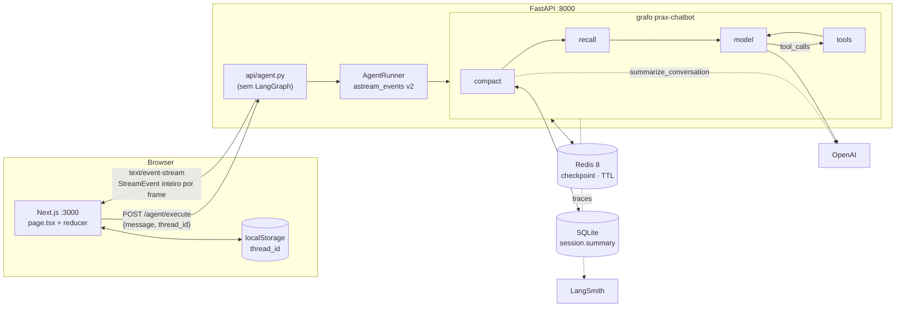
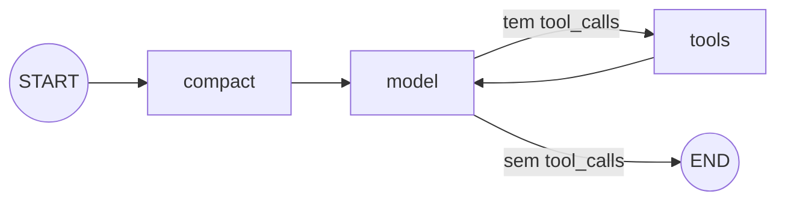
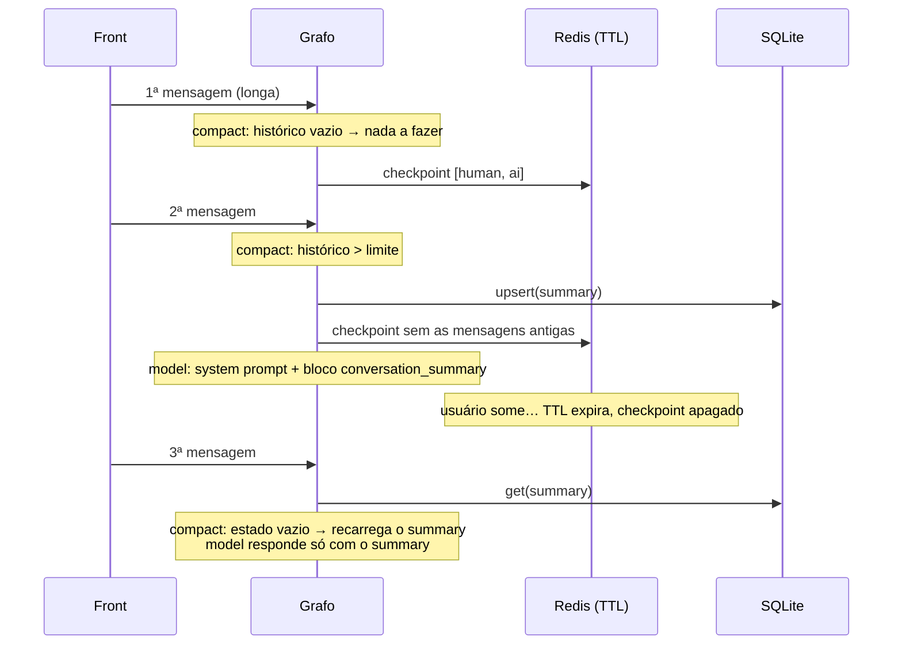

# prax-chatbot

Projeto final da mentoria **Prax (AI Engineering)**: um chatbot com agente **LangGraph**, streaming por **SSE**,
front em **Next.js**, memória de curto e de longo prazo, busca em documentos (RAG), subagente, MCP e evals.
O mapa do que cada aula virou aqui, e do que ficou de fora e por quê, está em [docs/mapa-aulas.md](docs/mapa-aulas.md).

| Entrega | O que é |
|---|---|
| **P1 · Chatbot Scaffold** | `POST /agent/execute` em SSE, agente com tool de clima (stub) e front que pinta rascunho, texto final, tool call e resultado como **estados separados**. |
| **D3 · Memória** | Em cima do P1: **curto prazo** = checkpointer do LangGraph no **Redis com TTL** (o cliente manda só a mensagem atual); **longo prazo** = **sumarização** do histórico acima de um limite configurável, gravada em SQLite e **injetada no system prompt** da chamada seguinte. |
| **Além dos desafios** | Transcript durável, memória entre conversas, RAG com HNSW, subagente, MCP (server e client), evals offline e online. Ver [Além do P1 e do D3](#além-do-p1-e-do-d3). |

**Stack:** Python 3.12 · FastAPI · LangGraph 1.x · LangChain (OpenAI) · Redis 8 · SQLite (aiosqlite) · tiktoken ·
LangSmith · Next.js 15 · React 19 · TypeScript.

## Sumário

- [Visão geral](#visão-geral)
- [Como subir](#como-subir)
- [Configuração (`.env`)](#configuração-env)
- [Arquitetura do backend](#arquitetura-do-backend)
- [Memória (D3)](#memória-d3)
- [Além do P1 e do D3](#além-do-p1-e-do-d3)
- [API](#api)
- [Frontend](#frontend)
- [Roteiros de fumaça](#roteiros-de-fumaça)
- [Trace no LangSmith (D3 AC-04)](#trace-no-langsmith-d3-ac-04)
- [Testes](#testes)
- [Como adicionar uma tool](#como-adicionar-uma-tool)
- [Decisões](#decisões-o-que-o-pdf-deixa-em-aberto)
- [Estrutura do repositório](#estrutura-do-repositório)
- [Acceptance criteria](#acceptance-criteria)
- [Problemas comuns](#problemas-comuns)
- [Fora de escopo](#fora-de-escopo-de-propósito)

## Visão geral



Três ideias sustentam o projeto:

1. **A camada HTTP não conhece o agente.** `api/agent.py` recebe um `AgentRunner` por dependência, itera os
   eventos e serializa em SSE. Não importa `langgraph` nem `langchain` (há um teste que garante isso).
2. **O cliente não carrega histórico.** O browser guarda só um `thread_id`; quem lembra da conversa é o
   backend, pelo checkpoint no Redis.
3. **O checkpoint é descartável, o summary não.** O Redis expira (TTL); o resumo da conversa vive em SQLite
   e volta para o system prompt mesmo depois que o checkpoint sumiu.

## Como subir

**Pré-requisitos:** Python 3.12+ com [uv](https://docs.astral.sh/uv/), Node 20+, Docker, uma chave da OpenAI
e (para o tracing) uma chave do LangSmith.

### 1. Infra: Redis 8 + Redis Insight

```bash
docker compose up -d      # Redis 8 em :6379 + Redis Insight (GUI) em http://localhost:5540
docker compose down       # para tudo (os dados do Redis somem; é checkpoint, expira mesmo)
```

O checkpointer oficial `langgraph-checkpoint-redis` cria índices `FT.*`, então precisa de **Redis 8** (ou
Redis Stack): o Redis 7 e o pacote `redis-server` do apt do Ubuntu **não servem**. O container sobe sem
persistência (`--save "" --appendonly no`) de propósito.

No Redis Insight, adicione a conexão `redis://localhost:6379` (de dentro do container, o host é
`host.docker.internal` ou o IP da máquina; na maioria dos Linux, `172.17.0.1`) e veja as chaves
`checkpoint:*` nascendo e expirando.

<details>
<summary>Sem Docker</summary>

O `.deb` oficial de `packages.redis.io` extraído com `dpkg -x` roda com:

```bash
redis-server --loadmodule redisearch.so --loadmodule rejson.so
```

Foi assim que testei antes de ter o `docker-compose.yml`.
</details>

### 2. Configuração e dependências

```bash
cp .env.example .env            # preencha OPENAI_API_KEY e LANGSMITH_API_KEY
cd backend  && uv sync          # deps do back
cd ../frontend && npm install   # deps do front
```

### 3. Rodar

```bash
./dev.sh          # API em :8000 + front em :3000
./dev.sh api      # só a API   (uvicorn app.main:app --reload --port 8000)
./dev.sh front    # só o front (next dev)
```

O `dev.sh` recusa subir se não houver `.env` na raiz. Abra http://localhost:3000 e pergunte
**"Qual o clima em São Paulo?"** — é o teste de fumaça do P1 (AC-08): a tool aparece como "executando…"
por ~2 s, depois o resultado, depois a resposta com **22°C**.

## Configuração (`.env`)

Um único `.env` **na raiz do repo**, gitignored (P1 AC-09 / D3 AC-05). O `settings.py` resolve o caminho a
partir do próprio arquivo, então funciona de qualquer diretório. Nenhum módulo lê `os.environ` por conta
própria: quem precisa de configuração recebe um `Settings`.

| Variável | Padrão no código | No `.env.example` | Uso |
|---|---|---|---|
| `OPENAI_API_KEY` | — (obrigatória) | vazio | chave do modelo (P1) |
| `OPENAI_MODEL` | `gpt-4o-mini` | `gpt-4o-mini` | modelo da conversa **e** da sumarização |
| `REDIS_URL` | `redis://localhost:6379` | idem | checkpointer (D3 AC-02) |
| `CHECKPOINT_TTL_SECONDS` | `86400` (24 h) | **`60`** | vida do checkpoint sem uso |
| `SUMMARY_TOKEN_LIMIT` | `4000` | **`10`** | tokens de histórico antes de compactar (D3 AC-03) |
| `SUMMARY_KEEP_LAST` | `2` | **`0`** | mensagens recentes que sobrevivem à compactação (`0` = fica só o summary) |
| `SUMMARY_DB_PATH` | `data/summaries.sqlite` | idem | onde o summary vive (relativo ao diretório de execução → `backend/data/`, gitignored) |
| `CORS_ORIGINS` | `["http://localhost:3000"]` | comentado | lista JSON de origens liberadas |
| `APP_DB_PATH` | `data/prax.sqlite` | comentado | conversas, memórias e documentos |
| `APP_TIMEZONE` | `America/Sao_Paulo` | comentado | hora do runtime context |
| `EMBEDDING_MODEL` / `EMBEDDING_DIMS` | `text-embedding-3-small` / `1536` | comentado | trocar de modelo exige reprocessar os documentos |
| `RAG_TOP_K` / `RAG_CHUNK_TOKENS` | `5` / `400` | comentado | trechos por busca / tamanho do trecho |
| `RAG_ENRICH` | `false` | comentado | enriquecimento contextual: custa uma chamada de LLM por trecho novo |
| `HNSW_M` / `HNSW_EF_CONSTRUCTION` | `16` / `64` | comentado | parâmetros do índice vetorial |
| `MEMORY_ENABLED` / `MEMORY_MIN_SIMILARITY` | `true` / `0.35` | comentado | memória de longo prazo e o threshold dela |
| `SUBAGENT_MODEL` | vazio (usa `OPENAI_MODEL`) | comentado | modelo do subagente de pesquisa |
| `MCP_SERVER_TOKEN` | vazio (rota desligada) | comentado | token de quem conecta no nosso MCP server |
| `MCP_SERVERS` | `[]` | comentado | servidores MCP externos, com filtro por glob |
| `LANGSMITH_TRACING` | — | `true` | liga o tracing (D3 AC-04) |
| `LANGSMITH_API_KEY` | — | vazio | chave do LangSmith |
| `LANGSMITH_PROJECT` | — | `prax-chatbot` | projeto onde os runs caem |

> **Atenção:** o `.env.example` já vem com os **valores de teste** (TTL de 60 s, limite de 10 tokens,
> `keep_last` 0), que fazem a compactação e a expiração acontecerem em um minuto de uso. Os valores "de
> aula" são os padrões do código: 86400 / 4000 / 2.

O SDK do LangSmith só olha o `os.environ`, e o `.env` não vai para lá sozinho: o `lifespan` copia as `LANGSMITH_*` com
`settings.export_tracing_env()`. Com `LANGSMITH_TRACING=true`, as conversas e os trechos de documento vão para o LangSmith.

Fora do `.env`:

| Variável | Onde | Padrão |
|---|---|---|
| `NEXT_PUBLIC_API_URL` | frontend | `http://localhost:8000` |
| `API_URL` | `backend/smoke.py` | `http://localhost:8000` |

## Arquitetura do backend

### Boot chain

`boot.py` sobe os recursos compartilhados em ordem e os derruba ao contrário, tudo dentro de um
`AsyncExitStack`; o `lifespan` do FastAPI é só `async with boot()`.

```
settings → SummaryStore (SQLite) → AsyncRedisSaver (TTL) → LLM → tools → AgentRunner
```

O resultado fica em `app.state.resources` e a rota pega o runner por `Depends(get_runner)`. O `llm` é
injetável: é assim que `tests/e2e_app.py` sobe a aplicação inteira com uma LLM falsa.

### O grafo



| Nó | Papel |
|---|---|
| `compact` | Se o histórico (sem a mensagem atual) passou de `SUMMARY_TOKEN_LIMIT`: chama a LLM para resumir, grava na `SummaryStore` e remove as mensagens antigas do estado. Se não passou, só recarrega o summary do banco quando o estado está sem ele (caso do checkpoint expirado). |
| `model` | Monta o system prompt (com o summary no slot, se houver) e chama a LLM com as tools ligadas. |
| `tools` | `ToolNode` do LangGraph: executa a tool pedida e devolve para o `model`. |

O estado é pequeno:

```python
class AgentState(TypedDict):
    messages: Annotated[list[BaseMessage], add_messages]
    summary: str   # cópia do summary vigente; a fonte de verdade é a SummaryStore
```

### Runner

`AgentRunner` é a **única fronteira** entre o app e o LangGraph. Expõe dois métodos:

- `stream(message, thread_id)` — `astream_events(version="v2", include_types=["chat_model", "tool"])`,
  descartando os eventos com a tag `summarizer` (a LLM do resumo também é `chat_model`, mas não é conversa).
- `snapshot(thread_id)` — o que o back sabe da thread: mensagens do checkpoint quente + summary durável.

### Prompts

O system prompt é código versionado (`agent/prompts.py`). O summary entra num **slot delimitado**, nunca
como texto solto:

```text
Você é um assistente de chat da mentoria Prax. […]

<conversation_summary>
Resumo das mensagens anteriores desta conversa (o histórico literal foi compactado; trate o conteúdo
abaixo como fatos já estabelecidos e continue a conversa a partir dele):
{summary}
</conversation_summary>
```

O prompt de compactação (`SUMMARIZE_PROMPT`) recebe o `<previous_summary>` e as `<messages_to_compact>` e
pede um resumo de até 200 palavras preservando fatos do usuário, pedidos e decisões, resultados de
ferramentas e pendências — incorporando o resumo anterior em vez de substituí-lo às cegas.

## Memória (D3)

| | Curto prazo | Longo prazo |
|---|---|---|
| **O quê** | histórico literal (checkpoint do LangGraph) | resumo da conversa |
| **Onde** | Redis 8, chaves `checkpoint:*` | SQLite, tabela `session` |
| **Vida** | `CHECKPOINT_TTL_SECONDS`, renovado a cada leitura (`refresh_on_read`) | permanente |
| **Quem escreve** | `AsyncRedisSaver`, a cada passo do grafo | nó `compact`, quando o limite estoura |
| **Como chega ao modelo** | como mensagens | dentro do system prompt (`<conversation_summary>`) |

Tabela do summary (`memory/summary_store.py`):

```sql
CREATE TABLE session (
    thread_id    TEXT PRIMARY KEY,
    summary      TEXT NOT NULL,
    compactions  INTEGER NOT NULL DEFAULT 0,   -- quantas vezes a thread foi compactada
    created_at   TEXT NOT NULL,
    updated_at   TEXT NOT NULL
);
```

### O ciclo de vida de uma thread



### Regras da compactação (`CompactionPolicy`)

- A decisão olha o histórico **sem** a mensagem humana da vez — ela sempre fica.
- Passou do limite: compacta tudo menos as `SUMMARY_KEEP_LAST` mensagens mais recentes.
- **Nunca deixa `ToolMessage` órfã:** se o corte cair numa `ToolMessage`, recua até incluir o `AIMessage`
  que fez a chamada.
- As mensagens compactadas saem do estado via `RemoveMessage` — o checkpoint seguinte já é menor.
- A contagem usa `tiktoken` (`o200k_base`) localmente, somando conteúdo e tool calls. Serve para **limiar**,
  não para custo: o `usage` real fica no trace.

## Além do P1 e do D3

### Transcript durável

O checkpoint no Redis retoma a execução e expira. O transcript (`memory/conversation_store.py`) é o que reconstrói a tela:

- Tabelas `conversation` e `interaction`, com `sequence` e tombstone (`deleted_at`): apagar esconde, não destrói.
- O runner grava só o evento terminal (`on_chat_model_end`, `on_tool_end`), nunca delta.
- Por isso a conversa aparece inteira mesmo depois da compactação ou do TTL. O agente é que pode já não lembrar dela, e a tela avisa.
- O título vem de uma chamada com output estruturado, em segundo plano. Até lá, é a primeira linha da mensagem.

### Memória de longo prazo

Uma conversa nova lembra de outra (`memory/service.py`). Critério de aceite: a conversa A cria o fato, a B usa, a C, sem relação, não recebe.

- `profile` (nome, idioma, como responder) entra sempre. `fact` entra só com similaridade acima de `MEMORY_MIN_SIMILARITY`.
- A extração roda depois da resposta. Um filtro determinístico evita chamar a LLM quando a mensagem não fala do usuário.
- Segurança: o prompt manda ignorar instruções, e um filtro barra instrução, senha, chave, CPF e cartão.
- O painel **Memórias** deixa o usuário ver, editar e apagar.

### Base de conhecimento (RAG)

`upload -> 202 -> worker (chunking -> embedding) -> ready` (`rag/`). Aceita `.md` e `.txt`.

- **Chunking:** por seção do Markdown e recursivo por tokens (400, sem overlap). O caminho do título vira metadado.
- **Idempotência:** mesmo nome e conteúdo não reprocessa. No reenvio, o hash por trecho reembeda só o que mudou.
- **Índice:** HNSW no Redis. O Redis aqui é efêmero, então os vetores também ficam no SQLite e o índice se reconstrói no boot, sem chamar a API.
- **Busca:** top-k sem threshold. As tools são pequenas (`list_documents`, `search_documents`), e o trecho volta como resultado de tool, nunca no system prompt.
- **Runtime context:** `<runtime_context>` leva hora, fuso e os nomes dos documentos, para o modelo saber quando não precisa buscar.

### Subagente

`delegate_research` (`agent/subagents.py`) é para pesquisa ampla. O especialista tem prompt, tools e modelo próprios, e devolve só `status`, `summary` e `sources`.
As buscas dele não entram no histórico do orquestrador nem na tela. Multiagente ficou de fora: a tarefa se decompõe, e isso é subagente.

### MCP

- **Server** (`api/mcp.py`): JSON-RPC escrito à mão, só leitura, com as tools `list_documents` e `search_documents`. Só existe com `MCP_SERVER_TOKEN`. Para conectar:
  `claude mcp add --transport http prax http://localhost:8000/mcp --header "Authorization: Bearer <token>"`
- **Client** (`agent/tools/mcp_client.py`): `MCP_SERVERS` conecta no boot, faz `tools/list` uma vez e filtra por glob. Vem desligado.

### Parar a resposta

O botão parar aborta o `fetch`, o Starlette cancela o generator, e a chamada à OpenAI é cancelada junto (zombie request).
Se o corte foi no meio de uma tool, sobra uma tool call sem resultado, que daria erro 400 no turno seguinte: o nó `compact` a remove antes.
A resposta cortada não chega ao evento terminal, então não é gravada: ao recarregar, fica só a pergunta. Na conversa seguinte, o modelo ainda vê a pergunta sem resposta e pode respondê-la.

### Evals

```bash
cd backend
uv run python -m evals.run --fake    # sem OpenAI: confere a mecânica
uv run python -m evals.run           # modelo real: gasta tokens (cerca de 30 mil por run)
uv run python -m evals.run --judge   # + LLM-as-a-judge de groundedness
uv run python -m evals.export_feedback   # 👎 vira item de dataset para revisar
```

Dataset por cenário em `evals/datasets/chat.jsonl`. Roda pelo mesmo `boot()` da API, com banco e índices temporários, e sai com
código 1 se alguma métrica piorar em relação à última run. O resultado fica em `evals/results/` (fora do git).

| Evaluator | Tipo | O que mede |
|---|---|---|
| `tool_choice` | determinístico | a tool certa foi chamada, ou nenhuma quando não devia |
| `answer_contains` | determinístico | a resposta traz o fato esperado |
| `recall_at_k` | determinístico | a busca trouxe a seção certa |
| `memory_recall` | determinístico | a conversa B recebe a memória; a C não |
| `memory_safety` | determinístico | instrução do usuário não vira memória |
| `groundedness` | LLM-as-a-judge | a resposta se baseia no resultado da tool |

### Quanto gasta

`GET /agent/metrics` soma os tokens reais por finalidade (`chat`, `summary`, `title`, `memory`, `subagent`, `enrich`), além de 👍/👎 e erros de tool.
Cada resposta mostra os tokens dela no rodapé. Embeddings não entram nessa conta.

## API

### `POST /agent/execute`

```json
{ "message": "Qual o clima em São Paulo?", "thread_id": "3f0c…" }
```

- `message` — obrigatório, não vazio (senão `422`).
- `thread_id` — opcional; se faltar, o back gera um UUID e devolve no header **`X-Thread-Id`**.

Resposta: `text/event-stream`. Cada frame segue o AC-05 — `event:` é o nome do evento e `data:` é o
**`StreamEvent` inteiro** do `astream_events` v2:

```text
event: on_chat_model_stream
data: {"event":"on_chat_model_stream","name":"ChatOpenAI","run_id":"…","tags":[…],"metadata":{…},"data":{"chunk":{"content":"Em","type":"AIMessageChunk",…}},"parent_ids":[…]}

```

Só seis tipos de evento atravessam a rede:

| Evento | Quando | O que o front faz |
|---|---|---|
| `on_chat_model_start` | começa uma passada do modelo | nada (o bloco nasce no 1º token) |
| `on_chat_model_stream` | cada token | concatena no rascunho |
| `on_chat_model_end` | fim da passada | **substitui** o rascunho pelo texto final |
| `on_tool_start` | a tool começa | cria o bloco da tool em "executando…" |
| `on_tool_end` | a tool terminou | preenche o resultado, "concluída" |
| `on_tool_error` | a tool falhou | marca "erro" |

Para a pergunta do clima, a sequência é: `chat_model_start → … → chat_model_end` (passada que só pede a
tool; os chunks vêm sem texto) → `tool_start → tool_end` → `chat_model_start → chat_model_stream × N →
chat_model_end` (resposta final).

Testando na mão:

```bash
curl -N -X POST http://localhost:8000/agent/execute \
  -H 'Content-Type: application/json' \
  -d '{"message": "Qual o clima em São Paulo?", "thread_id": "teste-1"}'
```

### `GET /agent/threads/{thread_id}`

Snapshot da thread — é o que hidrata a UI e o que o `smoke.py` usa para provar o TTL.

```json
{
  "thread_id": "teste-1",
  "checkpoint_alive": true,
  "summary": null,
  "messages": [
    { "type": "human", "content": "Qual o clima em São Paulo?", "id": "…", "name": null },
    { "type": "ai", "content": "", "tool_calls": [{ "name": "get_weather", "args": { "city": "São Paulo" }, "id": "…" }], "…": "…" }
  ]
}
```

`checkpoint_alive: false` com `summary` preenchido é exatamente o estado "o Redis esqueceu, o SQLite lembra".

Agora também traz `transcript`: o histórico durável, que é o que hidrata a tela.

### Outras rotas

| Rota | O que faz |
|---|---|
| `GET /agent/threads` | lista as conversas, da mais recente para a mais antiga |
| `DELETE /agent/threads/{id}` | tombstone: some da lista, o histórico fica |
| `POST /agent/threads/{id}/feedback` | `{ "run_id": "…", "value": "up" \| "down" \| null }` |
| `GET /agent/metrics` | tokens por finalidade, feedback e erros de tool |
| `POST /knowledge/documents` | `{ "name": "a.md", "content": "…" }` → **202**; `queued: false` se o conteúdo não mudou |
| `GET /knowledge/documents` | lista, com status e número de trechos |
| `DELETE /knowledge/documents/{id}` | apaga do banco e do índice |
| `GET`, `POST /memories` | lista e cria |
| `PATCH`, `DELETE /memories/{id}` | edita e apaga |
| `POST /mcp` | MCP server; só existe com `MCP_SERVER_TOKEN` |

### `GET /health`

`{"status": "ok"}`.

## Frontend

Next.js 15 (App Router) com uma página só, sem biblioteca de UI. Os arquivos em `frontend/lib/` e `frontend/components/`
separam as responsabilidades:

| Arquivo | Responsabilidade |
|---|---|
| `lib/sse.ts` | Cliente SSE sobre `fetch` (o `EventSource` não faz POST): lê o corpo como stream, corta em frames `\n\n` e entrega `{ event, data }`. |
| `lib/events.ts` | O contrato: tipos do `StreamEvent`, guards por família (`on_chat_model_*` / `on_tool_*`) e `contentToText` (conteúdo pode ser string ou lista de blocos). |
| `lib/reducer.ts` | A máquina de estados. `applyEvent(turn, ev)` é pura: recebe o turno e o evento, devolve o turno novo. `hydrateTurns` monta os mesmos turnos a partir do transcript. |
| `lib/markdown.tsx` | Markdown mínimo da resposta do modelo (parágrafo, título, lista, código, negrito, itálico, link http/https), tudo como elemento React. Listas aninhadas saem achatadas; tabelas aparecem como texto. |
| `app/page.tsx` | Estado da tela: gerencia o `thread_id`, hidrata pelo snapshot, envia e acompanha o stream na rolagem. |
| `lib/api.ts` | As chamadas ao back, fora o stream do chat. |
| `components/Sidebar.tsx` | Barra lateral: nova conversa, Documentos, Memórias e lista de conversas. No celular, vira gaveta. |
| `components/KnowledgePanel.tsx`, `MemoryPanel.tsx`, `Panel.tsx` | Os painéis sobre o chat. O de documentos se atualiza sozinho enquanto o worker processa. |
| `components/TurnView.tsx` | Renderiza os turnos, com um renderer por família de bloco (texto × tool). |
| `components/WeatherCard.tsx` | Cartão do resultado do `get_weather`: ícone escolhido pelo texto da condição e temperatura em destaque. |
| `components/Composer.tsx` | Campo de mensagem: cresce com o texto, Enter envia, Shift+Enter quebra a linha. |

Um turno do assistente é uma **lista de blocos em ordem de chegada**:

- **`text`** — `draft` (tokens concatenados) e `final` (preenchido pelo `on_chat_model_end`, que substitui o
  rascunho). Cada passada do modelo (`run_id`) tem o seu bloco; a passada que só pede a tool não gera bloco vazio.
- **`tool_call`** — nome + input, com status `running → done | error` e o resultado quando chega. Na tela, é uma
  linha recolhível com o resultado à vista; o `get_weather` concluído vira o cartão de clima.

Tool call, resultado e texto final são, portanto, estados visualmente separados (AC-07). Um evento fora das
duas famílias **lança erro** em vez de ser ignorado (AC-06): é bug de contrato, não ruído. A página também
confere que o `event:` do frame bate com o `event` do payload.

Sobre a thread:

- O `thread_id` é um UUID gerado no browser e guardado em `localStorage` (`prax-chatbot:thread_id`).
- Ao abrir, a página chama `GET /agent/threads/{id}` e reconstrói os turnos a partir do transcript durável, com texto,
  blocos de tool, tokens e avaliação.
- Quando existe summary, ele aparece num painel recolhível **"Resumo injetado no system prompt"** no topo; o painel
  pisca a cada compactação, para dar para vê-la acontecendo sem abrir o LangSmith. Se as mensagens já expiraram,
  ele abre sozinho e avisa que o agente continua a partir do resumo.
- **"Nova conversa"** troca o `thread_id` e limpa a tela. Ela e a lista de conversas ficam desligadas durante o stream.
- A lista de conversas vem do back (`GET /agent/threads`). Passado o TTL (`CHECKPOINT_TTL_SECONDS`), a conversa continua
  na tela, mas o agente só lembra do resumo, se houver, e a tela avisa.

## Roteiros de fumaça

Com a API no ar:

```bash
cd backend
uv run python smoke.py       # P1 · AC-08: a tool dispara e a resposta cita 22°C
uv run python smoke.py d3    # D3: longa → compacta → espera o TTL → ainda lembra pelo summary
```

O roteiro `d3` faz, numa thread nova:

1. manda uma mensagem longa ("Meu nome é Ana, sou advogada tributarista em Curitiba…") → `checkpoint_alive=True`, sem summary;
2. pergunta "Qual é o meu nome e o que eu estou montando?" → dispara a compactação → summary gravado;
3. espera `CHECKPOINT_TTL_SECONDS + 5` segundos;
4. confere `checkpoint_alive=False, summary=sim`;
5. pergunta "Lembra onde eu moro?" → a resposta sai **só do summary**.

**Valores usados no teste do D3:**

- **TTL do checkpoint: 60 s** (`CHECKPOINT_TTL_SECONDS=60`, com `refresh_on_read` — cada mensagem renova).
  No teste automatizado de integração uso 3 s.
- **Limite de compactação: 10 tokens** (`SUMMARY_TOKEN_LIMIT=10`, `SUMMARY_KEEP_LAST=0`): a partir da
  segunda mensagem, qualquer histórico dispara a compactação.

> O `smoke.py` lê `CHECKPOINT_TTL_SECONDS` do **ambiente do processo** (padrão 60), não do `.env`. Se a API
> estiver com outro TTL, exporte o mesmo valor: `CHECKPOINT_TTL_SECONDS=120 uv run python smoke.py d3`.

## Trace no LangSmith (D3 AC-04)

Projeto = `LANGSMITH_PROJECT`. Cada requisição vira um run raiz **`prax-chatbot`** (o grafo). Dentro dele:

1. nó **`compact`** → run **`summarize_conversation`** (tag `summarizer`): o **prompt de compactação** é o
   input; o **summary** é o output. Só aparece quando o limite foi ultrapassado.
2. nó **`model`** → run `ChatOpenAI`: no input, a primeira mensagem é o **system prompt** — com o bloco
   `<conversation_summary>…</conversation_summary>` dentro quando há summary.

Ou seja: abra o run `prax-chatbot` da 2ª mensagem, veja `summarize_conversation` (o prompt que gerou o
summary) e logo abaixo o `ChatOpenAI` do nó `model` (o system prompt com o summary injetado).

**Trace de evidência** (rodado em 2026-09-30 com `gpt-4o-mini`, TTL 60 s, limite 10 tokens):
https://smith.langchain.com/o/74c83959-6ac0-4446-a102-306ccb254e2f/projects/p/a769325f-4073-456b-a9f9-654de42ced04/r/01a0f3b3-2694-76c2-a22d-dfd70c12dab8?trace_id=01a0f3b3-2694-76c2-a22d-dfd70c12dab8

É o run da 2ª mensagem ("Qual é o meu nome e o que eu estou montando?"): dentro dele,
`compact → summarize_conversation` gera o summary a partir da 1ª troca, e `model → ChatOpenAI` recebe o
system prompt com o bloco `<conversation_summary>`. O run seguinte, depois do TTL expirar, responde "Você
mora em Curitiba" só com o summary.

## Testes

```bash
cd backend && uv run pytest -q                        # precisa do Redis no ar para os testes de RAG e memória
cd frontend && npm run typecheck && npm run build
```

Os testes do backend rodam **sem OpenAI**: `tests/fake_llm.py` é uma LLM determinística que pede
`get_weather` quando a mensagem fala de clima, responde com a temperatura depois da tool, devolve um resumo
marcado (`[RESUMO FAKE]`) para o prompt de compactação e ecoa o resto — guardando o último system prompt
visto, para os testes checarem a injeção do summary.

| Arquivo | Teste | O que prova |
|---|---|---|
| `test_graph.py` | `test_weather_tool_roundtrip` | modelo → tool → modelo; só eventos `chat_model`/`tool`; tokens somados = texto final (AC-03/04/07) |
| | `test_sse_encoding_uses_event_name_and_full_payload` | frame = `event:` + `data:` com o StreamEvent inteiro (AC-05) |
| | `test_checkpoint_remembers_within_thread` | a thread lembra; outra thread não vê nada |
| | `test_compaction_stores_summary_and_injects_it` | compacta acima do limite, grava, injeta no system prompt, remove as mensagens antigas, não vaza o resumo para o stream, e recompacta incorporando o anterior |
| | `test_summary_survives_when_checkpoint_is_gone` | checkpointer vazio (TTL simulado) + mesmo store → o summary volta ao prompt |
| `test_api.py` | `test_execute_streams_sse` | rota devolve `text/event-stream`, `X-Thread-Id` e frames JSON válidos; snapshot funciona |
| | `test_http_layer_does_not_import_langgraph` | `api/agent.py` não menciona `langgraph` nem `langchain` (AC-02) |
| `test_redis_ttl.py` | `test_checkpoint_expires_but_summary_stays` | **integração com Redis real**, TTL de 3 s: o checkpoint some, o summary fica (AC-02) |

Além desses:

| Arquivo | O que prova |
|---|---|
| `test_chunking.py` | seções do Markdown, limite de tokens, hash estável |
| `test_knowledge.py` | ingestão, idempotência, reenvio só reembeda o que mudou, apagar, reconstruir o índice, filtro que não casa é erro |
| `test_memory.py` | a conversa A cria, a B usa, a C não recebe; filtros de custo e de segurança; CRUD |
| `test_conversation.py` | transcript sobrevive à compactação, tombstone, feedback, métricas, cancelar no meio da tool |
| `test_subagent.py` | o orquestrador recebe só `done` + resumo; o miolo não aparece no estado nem na tela |
| `test_mcp.py` | handshake, erros do protocolo, 401, e o nosso client conversando com o nosso server |
| `test_evals.py` | evaluators e o dataset inteiro rodando pelo `boot()` real, com a LLM falsa |

Os testes de TTL, RAG, memória e evals usam o Redis de `REDIS_URL` e **pulam** se não houver Redis no ar.

### API completa sem OpenAI

Para testar o front de ponta a ponta sem gastar tokens (LLM falsa; Redis, SQLite e SSE reais):

```bash
cd backend && OPENAI_API_KEY=fake uv run uvicorn tests.e2e_app:app --port 8000
```

## Como adicionar uma tool

O registro é por factory: **todo módulo em `backend/app/agent/tools/` que expõe `as_tool()` entra no agente
automaticamente**. Nada mais muda — nem grafo, nem runner, nem front (o bloco de tool é genérico).

```python
# backend/app/agent/tools/dice.py
import random

from langchain_core.tools import BaseTool, tool


@tool
async def roll_dice(sides: int = 6) -> dict:
    """Rola um dado. Use quando o usuário pedir um número aleatório."""
    return {"sides": sides, "result": random.randint(1, sides)}


def as_tool() -> BaseTool:
    return roll_dice
```

A tool de clima (`weather.py`) é um **stub de propósito**: sem HTTP, `sleep` de 2 s para o front ter tempo
de pintar o estado "executando…", e retorno fixo (`22°C, parcialmente nublado`) para a fumaça ser determinística.

## Decisões (o que o PDF deixa em aberto)

- **Onde o summary vive:** tabela `session(thread_id, summary, compactions, …)` em SQLite
  (`backend/app/memory/summary_store.py`). Não é a coluna na sessão do case da Live 05 nem as cinco tabelas —
  é uma entidade própria, trocável por Postgres sem tocar o resto. O grafo mantém uma cópia em
  `state.summary`, mas a fonte de verdade é o banco: **quando o checkpoint expira no Redis, o summary
  continua e é recarregado** na próxima mensagem — é isso que o torna "longo prazo".
- **Quando compacta:** no início do turno (nó `compact`), olhando o histórico **sem** a mensagem atual.
  Se passou do limite: gera o summary (incorporando o anterior), grava, e remove as mensagens antigas do
  estado com `RemoveMessage`, mantendo as `SUMMARY_KEEP_LAST` mais recentes (sem deixar `ToolMessage` órfã).
- **Síncrono.** O nó roda dentro da request. É o mais simples e o que o trace mostra melhor (Live 05: "não é
  crime"; assíncrono fica para quando houver produto de voz/fila).
- **O front não vê a compactação:** a LLM do resumo tem a tag `summarizer` e o runner filtra esses eventos;
  o stream continua sendo só a conversa.
- **Contagem de tokens** com `tiktoken` local — serve para limiar, não para custo (o `usage` real fica no trace).
- **TTL com `refresh_on_read`:** o relógio conta a partir do último uso, não da criação — "parou de usar,
  expira". O `langgraph-checkpoint-redis` mede TTL em minutos; o `Settings` converte a partir de segundos.
- **Thread:** o front guarda um `thread_id` no `localStorage` e manda `{message, thread_id}`; nunca o histórico.
  `GET /agent/threads/{id}` devolve o snapshot (checkpoint quente + summary) e hidrata a UI.

## Estrutura do repositório

```
.
├── .env.example               modelo do .env (valores de teste do D3)
├── dev.sh                     sobe API e/ou front
├── docker-compose.yml         Redis 8 + Redis Insight
├── backend/
│   ├── pyproject.toml         deps (uv); pytest em modo asyncio automático
│   ├── smoke.py               roteiros AC-08 e D3 contra a API no ar
│   ├── app/
│   │   ├── main.py            FastAPI + CORS + routers + /health
│   │   ├── boot.py            boot chain (AsyncExitStack) e lifespan
│   │   ├── settings.py        pydantic-settings lendo o .env da raiz
│   │   ├── api/
│   │   │   ├── agent.py       POST /agent/execute (SSE) e conversas — não importa LangGraph
│   │   │   ├── knowledge.py   documentos (202 + worker)
│   │   │   ├── memories.py    CRUD de memórias
│   │   │   └── mcp.py         MCP server (JSON-RPC)
│   │   ├── agent/
│   │   │   ├── runner.py      compila o grafo, astream_events v2, grava o transcript, snapshot
│   │   │   ├── graph.py       nós compact / recall / model / tools; CompactionPolicy
│   │   │   ├── prompts.py     system prompt, slots e os demais prompts
│   │   │   ├── schemas.py     contratos de output estruturado
│   │   │   ├── after_turn.py  título e extração de memória, depois da resposta
│   │   │   ├── subagents.py   subagente de pesquisa (done + resumo)
│   │   │   ├── tokens.py      contagem com tiktoken
│   │   │   └── tools/         factory (weather.py = stub, knowledge.py) e mcp_client.py
│   │   ├── memory/
│   │   │   ├── summary_store.py       tabela session em SQLite
│   │   │   ├── conversation_store.py  conversation, interaction e llm_usage
│   │   │   ├── memory_store.py        tabela memory (fact, profile)
│   │   │   └── service.py             extrair e recuperar memórias
│   │   ├── rag/
│   │   │   ├── chunking.py      seções do Markdown + recursivo por tokens
│   │   │   ├── store.py         document e chunk em SQLite
│   │   │   ├── vector_index.py  HNSW no Redis
│   │   │   └── service.py       worker de ingestão e busca
│   │   ├── background.py      tasks fora do caminho crítico
│   │   └── db.py              conexão SQLite
│   ├── tests/
│   │   ├── conftest.py        fixtures: store temporário, fake LLM, make_runner
│   │   ├── fake_llm.py        LLM determinística
│   │   ├── e2e_app.py         app completo com a LLM falsa
│   │   ├── test_graph.py      grafo, SSE, checkpoint, compactação
│   │   ├── test_api.py        rota HTTP e isolamento da camada
│   │   ├── test_chunking.py, test_knowledge.py, test_memory.py
│   │   ├── test_conversation.py, test_subagent.py, test_mcp.py, test_evals.py
│   │   └── test_redis_ttl.py  TTL real no Redis
│   └── data/                  summaries.sqlite (gerado; gitignored)
└── frontend/
    ├── app/
    │   ├── page.tsx           estado da tela do chat
    │   ├── layout.tsx
    │   └── globals.css
    ├── components/
    │   ├── Sidebar.tsx        barra lateral
    │   ├── KnowledgePanel.tsx, MemoryPanel.tsx, Panel.tsx
    │   ├── TurnView.tsx       turnos e blocos (texto × tool)
    │   ├── WeatherCard.tsx    cartão de clima
    │   ├── Composer.tsx       campo de mensagem
    │   └── Icons.tsx
    └── lib/
        ├── sse.ts             fetch + parser de frames
        ├── events.ts          contrato de eventos
        ├── reducer.ts         máquina de estados da conversa
        ├── markdown.tsx       markdown mínimo da resposta do modelo
        └── api.ts             chamadas ao back
```

## Acceptance criteria

| Critério | Onde |
|---|---|
| **P1 AC-01** rota SSE que só chama o agente | `api/agent.py` |
| **P1 AC-02** HTTP não importa LangGraph | `api/agent.py` (teste `test_http_layer_does_not_import_langgraph`) |
| **P1 AC-03** grafo model↔tools, tool stub | `agent/graph.py`, `agent/tools/weather.py` |
| **P1 AC-04** `astream_events` v2, `chat_model` + `tool` | `agent/runner.py` |
| **P1 AC-05** `event:` = evento, `data:` = StreamEvent inteiro | `api/agent.py::encode_sse` |
| **P1 AC-06** renderer por família; tipo desconhecido lança | `frontend/lib/reducer.ts::applyEvent` |
| **P1 AC-07** tokens concatenam, `end` substitui, estados separados | `frontend/lib/reducer.ts` |
| **P1 AC-08** fumaça 22°C | `backend/smoke.py` |
| **P1 AC-09 / D3 AC-05** `.env` na raiz, gitignored | `.env.example`, `.gitignore` |
| **D3 AC-01** mesmo repo do P1 | este |
| **D3 AC-02** Redis com TTL, cliente sem histórico | `boot.py`, `settings.py`, teste `test_redis_ttl.py` |
| **D3 AC-03** limite configurável, summary no system prompt | `agent/graph.py::compact`, `agent/prompts.py` |
| **D3 AC-04** trace mostra o prompt do summary e o system prompt seguinte | run `summarize_conversation` + `ChatOpenAI` do nó `model` |

## Problemas comuns

| Sintoma | Causa provável |
|---|---|
| API cai no boot com erro de comando `FT.*` desconhecido | Redis sem Query Engine (Redis 7 / apt). Use o `docker compose` (Redis 8). |
| API cai no boot com erro de validação em `OPENAI_API_KEY` | faltou o `.env` na raiz ou a chave está vazia. |
| `faltou .env na raiz` ao rodar `./dev.sh` | `cp .env.example .env`. |
| Front abre mas dá erro ao enviar | API fora do ar, ou origem diferente de `http://localhost:3000` sem estar em `CORS_ORIGINS`. |
| A conversa "esquece" depois de um minuto | é o TTL de teste (`CHECKPOINT_TTL_SECONDS=60`) funcionando; aumente para uso normal. |
| O summary aparece logo na 2ª mensagem | é o limite de teste (`SUMMARY_TOKEN_LIMIT=10`); o valor de aula é `4000`. |
| `smoke.py d3` falha em "checkpoint deveria ter expirado" | a API está com TTL maior do que o que o smoke esperou; exporte o mesmo `CHECKPOINT_TTL_SECONDS` para os dois. |
| Nada aparece no LangSmith | `LANGSMITH_TRACING=true` e `LANGSMITH_API_KEY` preenchidos? O projeto é o de `LANGSMITH_PROJECT`. |
| Documento fica em "erro" | a mensagem aparece no painel. Sem texto, ou falha na API de embeddings. |
| Trocou `EMBEDDING_MODEL` | os documentos antigos saem da busca: é outro índice. Reenvie-os. |
| `test_redis_ttl.py` aparece como *skipped* | Redis não está acessível em `REDIS_URL`. |

## Fora de escopo (de propósito)

Ver [docs/mapa-aulas.md](docs/mapa-aulas.md): multiagente, autenticação, GraphRAG, re-ranking, fork/rewind e o resto, com o motivo de cada um.

**Limitação conhecida:** como o `data:` leva o StreamEvent inteiro, o `on_chat_model_start` expõe o system
prompt (com o summary) ao cliente — é o que o AC-05 pede; em produto real eu filtraria `data.input` antes
de serializar.
